# JavaFX + Metal Native Overlay: Technical Documentation

_As of 2026-11-08_

## Overview

The prototype draws GPU-rendered Metal content over part of a JavaFX window. It does this by placing a borderless, transparent, click-through native child window over the right pane and driving it from Java through the Foreign Function & Memory (FFM) API. No JNI, SwingNode or JavaFX internals are involved in rendering. The only internal API used is a reflection call that fetches the NSWindow handle.

| Component | Language | Role |
| --- | --- | --- |
| `NativeMetalApp.java` | Java 25+, JavaFX 26 | UI, frame loop, layout sync, and the private `MetalRenderer` FFM facade |
| `Renderer.swift` | Swift 6.3+ | Metal device, pipelines, child window, C ABI exported with `@c` |
| `librenderer.dylib` | built artifact | Shared library loaded by `SymbolLookup.libraryLookup` |
| `build_lib.sh` | sh | Compiles the Swift file with `swiftc -emit-library` |
| `renderer.m` | Objective-C | Original implementation, kept for comparison, not built |

Target platform: macOS on Apple Silicon (arm64, macOS 14+). The app runs as a single-file jbang script.

## Architecture

<p align="center"></p>

<p align="center"><sub>architecture · 3 layers, 6 components</sub></p>

Control flows down: JavaFX events reach the private `MetalRenderer`, which makes FFM downcalls into the Swift dylib. The dylib hops to the main thread and drives a child window stacked above the Glass window. Pixels never flow back into JavaFX. The two windows are composited by the macOS window server.

## Java side: NativeMetalApp and MetalRenderer

All native access lives in one private nested class, `NativeMetalApp.MetalRenderer`, so the UI code never touches `MethodHandle`, `MemorySegment` or `Throwable`.

### Application lifecycle

1. `init()` builds a `MetalRenderer` from `./librenderer.dylib` (resolved against the working directory). The constructor opens the library with `SymbolLookup.libraryLookup(path, Arena.global())` and binds the 7 downcall handles. A missing symbol fails startup with `Native symbol not found: <name>`.
2. `start()` builds the UI, shows the stage, then in `Platform.runLater` reads the Glass NSWindow pointer and calls `renderer.attach(handle)`.
3. An `AnimationTimer` runs on every JavaFX pulse: it syncs the pane bounds and renders one frame.
4. `stage.setOnHiding` calls `destroyRenderer()` (stop the timer, then `renderer.close()`). `stop()` calls it again, which is harmless because `close()` is idempotent.

### MetalRenderer contract

- It holds the opaque renderer pointer in `ctx`, and `isAttached()` means `ctx.address() != 0`.
- Every method other than `attach` does nothing until attach succeeds and again after `close()`. This protects Swift from slider or combo events that arrive before the overlay exists.
- Native errors are caught inside the class and printed. They never reach JavaFX handlers.
- Calls use `invokeExact` with exact static types, so the JIT can inline the downcalls. Nothing is boxed on the per-frame path.

### Bindings

| Java method | C symbol | Signature (C view) | Called from |
| --- | --- | --- | --- |
| `attach(long)` | `init_metal_renderer` | `void* (void* nsWindow)` | `Platform.runLater` after show |
| `updateBounds(x, y, w, h, clip)` | `update_renderer_bounds` | `void (void*, double×4, int32)` | Every pulse, clip checkbox |
| `renderFrame()` | `render_frame` | `void (void*)` | Every pulse |
| `setAlpha(float)` | `set_renderer_alpha` | `void (void*, float)` | Opacity slider |
| `setRenderMode(int)` | `set_render_mode` | `void (void*, int32)` | 2D/3D combo |
| `rotate(dx, dy)` | `update_rotation` | `void (void*, float, float)` | Mouse drag on right pane |
| `close()` | `destroy_metal_renderer` | `void (void*)` | Stage hiding, `stop()` |

**Getting the NSWindow**: `getGlassWindowHandle()` uses reflection on `com.sun.glass.ui.Window.getWindows()` and calls `getNativeWindow()` on the first entry. That is why the script needs `--add-opens javafx.graphics/com.sun.glass.ui=ALL-UNNAMED`.

## Native side: Renderer.swift

The dylib exports 7 C functions with Swift 6.3's `@c(name)` attribute. Each one hops to the AppKit main thread and forwards the call to a `@MainActor` Swift class, also named `MetalRenderer`.

### Pointer ownership

- `init_metal_renderer` wraps the incoming NSWindow pointer with `Unmanaged.takeUnretainedValue()` (Glass owns it). It returns `Unmanaged.passRetained(renderer).toOpaque()`, so the Java side holds +1 on the renderer.
- The other calls use `takeUnretainedValue()`. `destroy_metal_renderer` calls `tearDown()` and then `release()`, which drops that +1.
- A null pointer is ignored by every export (`guard let rendererPtr else { return }`). If init fails it logs through `NSLog` and returns null.

### Threading

`onMain { }` runs the body inline when the caller is already on the main thread, and otherwise uses `DispatchQueue.main.sync`. On macOS the JavaFX Application Thread is the AppKit main thread, so in practice every call takes the inline path. Pointers cross the hop as `Int` bit patterns so the closures stay `Sendable` under Swift 6 strict concurrency.

### What init builds

1. `MTLCreateSystemDefaultDevice()` plus a command queue.
2. A shader library compiled at runtime from the embedded MSL source string: `vertexShader2D`, `vertexShader3D` and a shared `fragmentShader` that passes vertex colour through.
3. Two pipeline states, both `bgra8Unorm`. The 2D one has no vertex buffer (the 3 vertices are hard-coded in the shader). The 3D one uses a vertex descriptor matching `Vertex3D` (float3 position plus float4 colour, stride 32).
4. A shared-storage vertex buffer of 24 vertices: a triangular prism (2 end caps, 3 quad sides).
5. A borderless `NSWindow` with a clear background and `ignoresMouseEvents = true`, whose content view is backed by a non-opaque `CAMetalLayer`. It is added with `parentWindow.addChildWindow(child, ordered: .above)`, so it moves with the JavaFX window.

### Bounds and clipping (`updateBounds`)

It converts JavaFX scene coordinates (top-left origin) to Cocoa screen coordinates (bottom-left origin) using the parent's content rect: `cocoaY = parent.y + parent.height - (y + h)`. Then it sets the child window frame and the layer frame.

| clipMode | Effect |
| --- | --- |
| 0 (default) | `cornerRadius = 12` on the top-right corner only (`layerMaxXMinYCorner`), `masksToBounds` |
| 1 | New `CAShapeLayer` ellipse mask fitted to the layer bounds |

### Per-frame render (`renderFrame`, inside `autoreleasepool`)

1. Get `nextDrawable()` and a command buffer.
2. Advance `animationPhase` by 0.02 and clear to a pulsing dark purple whose alpha is `globalAlpha` (the opacity slider, default 0.4).
3. In mode 0, draw the 2D triangle. In mode 1, build MVP = perspective(60°, aspect, 0.1, 10) × view(z = -2) × rotation(rx, ry), pass it with `setVertexBytes` at index 1, and draw 24 vertices.
4. Present and commit. Nothing waits for the GPU.

Drag rotation accumulates `rotationY += dx × 0.01` and `rotationX += dy × 0.01` radians per pixel.

## Runtime flows

<p align="center"></p>

<p align="center"><sub>runtime sequence · 4 flows</sub></p>

All four flows run on a single thread. On macOS the JavaFX Application Thread is the AppKit main thread, so each `onMain` hop runs inline. Input calls only change Swift state (`globalAlpha`, `renderMode`, `rotationX/Y`), and the next pulse picks it up.

**Why teardown runs on hiding.** The child window is attached to the Glass NSWindow. If the renderer were destroyed in `Application.stop()`, Glass would already have released its window, and `removeChildWindow` would touch freed memory. That was the crash at exit fixed in commit `cb3c636`. Destroying the renderer in `setOnHiding` runs while the parent still exists, and the later `stop()` call finds `ctx` already null and does nothing.

## Build and run

You need Xcode Command Line Tools with Swift 6.3+, JDK 25+ and jbang. Then build the library and run the script from the project root:

```bash
./build_lib.sh            # swiftc -emit-library -O -swift-version 6 -target arm64-apple-macos14.0
jbang NativeMetalApp.java # or ./NativeMetalApp.java via the shebang
```

The jbang header carries everything the JVM needs:

| Directive | Why |
| --- | --- |
| `//DEPS org.openjfx:javafx-controls:26.0.1:mac-aarch64` | JavaFX 26 with the macOS arm64 natives |
| `--enable-native-access=ALL-UNNAMED,javafx.graphics` | Allows FFM downcalls without warnings or errors |
| `--add-opens javafx.graphics/com.sun.glass.ui=ALL-UNNAMED` | Reflection access to `Window.getNativeWindow()` |

The Swift runtime ships with macOS (`/usr/lib/swift`), so the dylib loads like any C library. Run `nm -gU librenderer.dylib` to check that all 7 symbols are exported.

### Troubleshooting

- `Native symbol not found: <name>`: the dylib is stale or was built from other sources. Rerun `build_lib.sh`.
- Library not found: the path is resolved against the working directory, so run from the project root.
- Status stays "Unbound": either the Glass handle lookup failed (look for `Could not resolve native Glass handle` on stderr) or Metal init failed (look for the `NSLog` line in Console.app or stderr).

## Enhancement opportunities

The highest-value fixes are Retina sharpness, change-only bounds sync and a depth buffer for 3D. Each is a small, local change. The list is ordered by value to the demo, and effort is a rough estimate (S under 1 hour, M a few hours, L a day or more).

| # | Enhancement | Why it matters | Where | Effort |
| --- | --- | --- | --- | --- |
| 1 | Set `metalLayer.contentsScale = parentWindow.backingScaleFactor` (and refresh it on screen change) | `contentsScale` defaults to 1, so on a Retina display the drawable renders at half resolution and looks soft | Swift `init`, `updateBounds` | S |
| 2 | Sync bounds only when they change | Each pulse calls `setFrame(display: true)`, and in clip mode 1 it allocates a new `CAShapeLayer` per frame | Java `syncNativeOverlayBounds` (cache last values) or Swift `updateBounds` (early return) | S |
| 3 | Add a depth attachment and `MTLDepthStencilState`, or back-face culling | The prism has no depth test, so faces draw in submit order and the far side shows through while it rotates | Swift pipeline 3D, `renderFrame` | M |
| 4 | Time-based animation | `animationPhase += 0.02` per frame runs twice as fast on a 120 Hz ProMotion display. Pass `now` from `AnimationTimer` or use `CACurrentMediaTime()` | Swift `renderFrame` | S |
| 5 | Keep frame pacing off the FX thread | `nextDrawable()` blocks when all drawables are in use (up to 1 s), freezing JavaFX. Options: `CAMetalDisplayLink` (macOS 14+) on the native side, or a render thread | Swift, Java timer | L |
| 6 | Match the Glass window to the stage | `getWindows().get(0)` picks the first Glass window, which is wrong once a dialog or second stage exists | Java `getGlassWindowHandle` | S |
| 7 | Report init failure to the UI | A failed attach only logs. Show a reason in `statusText`, for example by returning an error code or message from native | Java `attach`, Swift init | S |
| 8 | Precompile shaders to a `.metallib` | `makeLibrary(source:)` compiles MSL on every launch and hides shader errors until runtime | `build_lib.sh`, Swift init | M |
| 9 | Locate the dylib robustly | The path depends on the working directory. Use a system property with the script directory as fallback | Java `init` | S |
| 10 | One C header as the ABI source of truth | Java descriptors and Swift signatures are kept in sync by hand. A `renderer.h` checked by a test, or used with `jextract`, prevents drift (jextract would add generated files, so the single-file rule would need relaxing) | New `renderer.h` | M |
| 11 | Fix small UI issues | `opacityLabel` is never added to the pane, the "Interact" button does nothing, and the title still says "JavaFX 25" | Java `start` | S |
| 12 | Handle window state changes | Minimise, full screen and moving to another Space are untested for the child window | Swift, manual tests | M |
| 13 | Port to Windows and Linux | The README plan: same 7-function C ABI, one per-OS library (Direct3D, Vulkan), chosen at runtime by the Java side | New native libraries | L |

One side note on design: settings such as alpha, mode and rotation could live in a small shared `MemorySegment` struct that Swift reads each frame. That would replace four downcalls with plain memory writes. It only pays off if the calls show up in a profile.
